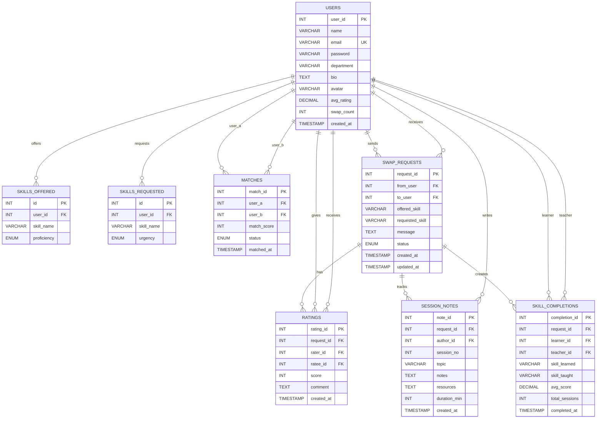

# Skill Swap Platform ER Diagram

Paste this Mermaid code into any Mermaid renderer, Markdown preview that supports Mermaid, or mermaid.live.

## Relationship Notes

- One user can offer many skills through `skills_offered`.
- One user can request many skills through `skills_requested`.
- `matches` connects two users: `user_a` and `user_b`.
- `swap_requests` connects the requesting user (`from_user`) and target user (`to_user`).
- `ratings` belongs to one swap request and connects the rater and ratee users.
- `session_notes` belongs to one swap request and one author user.
- `skill_completions` belongs to one swap request and connects learner and teacher users.

